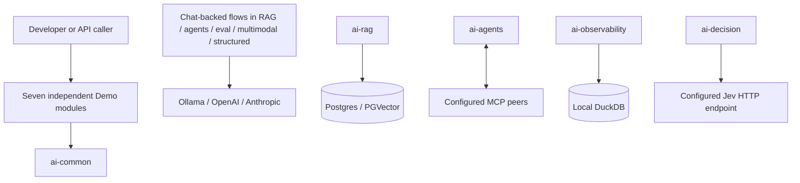

# spring-ai-apps

A multi-module Maven monorepo of Spring AI reference demos showcasing RAG, agents, evaluation, observability, multimodality, structured output, and typed decisions.

## Modules

| Module | Description |
| --- | --- |
| [`ai-common`](ai-common/README.md) | Shared infrastructure: provider-portable chat model wiring, VectorStore helpers, exceptions/error handling, and the Eval harness. |
| [`ai-rag`](ai-rag/README.md) | Retrieval-Augmented Generation with hybrid search (semantic + PostgreSQL full-text), reciprocal rank fusion, reranking, and a grounding guard. Includes a Thymeleaf chat UI. |
| [`ai-agents`](ai-agents/README.md) | Plain `@Tool` calling, optional MCP server publication and client callback seam, plain-chat SSE streaming, plus a minimal Thymeleaf chat UI. |
| [`ai-eval`](ai-eval/README.md) | In-app evaluation using the shared Eval harness: grade Q&A pairs against criteria, track history, and report regressions. |
| [`ai-observability`](ai-observability/README.md) | All-local DuckDB trace sink consuming Spring AI Micrometer observations with query endpoints. |
| [`ai-multimodal`](ai-multimodal/README.md) | All four modalities: image generation, vision, text-to-speech, and audio transcription. |
| [`ai-structured`](ai-structured/README.md) | Typed extraction to validated POJOs using Spring AI structured output and Bean Validation. |
| [`ai-decision`](ai-decision/README.md) | Typed decisions (Choice, Score, Noul) with probability fields; Jev adapter contract remains unverified upstream. |

## Quick Start

### Prerequisites

- Java 25 (Temurin)
- Maven 3.9+ (or use the pinned `./mvnw` wrapper included in the repo)
- Docker (for Postgres/PGVector when running the RAG integration tests)

### Build & Test

```bash
# Compile everything
./mvnw -B -DskipTests compile

# Run tests that do not require Docker
./mvnw -B test -Dtest='!DocumentIngestionIntegrationTests,!RagQueryIntegrationTests' -Dsurefire.failIfNoSpecifiedTests=false

# Run the full suite with Docker available (includes RAG PGVector integration tests)
./mvnw -B test
```

### Provider Profiles

The six Spring AI demos default to `ollama` (zero-key local). `ai-decision` instead uses a separately configured Jev HTTP adapter. Switch chat profiles via `spring.profiles.active` or `SPRING_PROFILES_ACTIVE`:

| Profile | Models | Notes |
| --- | --- | --- |
| `ollama` (default) | Local Ollama | No API keys required. Ensure Ollama is running locally. |
| `openai` | OpenAI models | Requires `OPENAI_API_KEY`. |
| `anthropic` | Anthropic models | Requires `ANTHROPIC_API_KEY`. |

Copy `.env.example` to a git-ignored `.env` and set only the values you need. Spring Boot and Maven do not automatically read that file. Export the required variables in your shell or configure them in your IDE. Leave unused cloud keys unset: exporting an empty key can override the non-empty startup placeholder. Docker Compose's `.env` handling does not export variables to a separately launched JVM.

For local chat, run Ollama and pull `llama3.2`; RAG also needs `nomic-embed-text`. A vision request needs a vision-capable model, and the default chat model is not a guarantee of vision support. Image/audio capabilities depend on their model beans, not just the chat profile. See the module guides for limitations, including Anthropic embeddings in RAG.

### Running a Demo

```bash
# Copy the environment sample and set a non-default database password before Compose
cp .env.example .env
# edit .env: SPRING_DATASOURCE_PASSWORD=...

# Install the shared dependency and parent POM once (repeat after shared changes)
./mvnw -pl ai-common -am install -DskipTests

# Start RAG infrastructure (bound to 127.0.0.1) and run just its executable module
docker compose up -d
./mvnw -pl ai-rag spring-boot:run

# Or run another demo, on a different port if RAG is still running
./mvnw -pl ai-agents spring-boot:run -Dspring-boot.run.arguments=--server.port=8081
```

Use `-am` for reactor build/test/install goals. Applying `spring-boot:run` to the entire selected reactor also invokes it on the non-executable parent/shared module. Each Demo module defaults to port 8080; run one at a time or override `server.port`. For OpenAI, prefix a run command with `SPRING_PROFILES_ACTIVE=openai` and export a real `OPENAI_API_KEY`.

Each demo exposes:
- REST APIs under `/api/<module>/...`
- OpenAPI docs at `/v3/api-docs` (Swagger UI at `/swagger-ui.html` where configured; both disabled in the `security` profile)
- `GET /api/<module>/ping` for a simple module response (not a provider connectivity check)

The full test suite requires Docker for RAG's PGVector Testcontainers tests. It does not require a manually started Compose database or real AI credentials. Successful mock-backed tests verify application contracts, not live-provider compatibility.

## Local-only default and opt-in security

These demos are **local reference applications, not production-hardened services**. By default they expose OpenAPI docs, do not require authentication, and bind local Compose PostgreSQL to `127.0.0.1`. Do not expose them to untrusted networks without additional review.

The opt-in `security` profile applies demo-level guardrails to every module:

```bash
SPRING_PROFILES_ACTIVE=ollama,security ./mvnw -pl ai-eval spring-boot:run
```

Always include the provider profile (`ollama`, `openai`, or `anthropic`) alongside `security`; activating only `security` disables the default provider alias. `ai-decision` uses its Jev adapter and does not need a chat profile.

In that profile:

- Springdoc `/v3/api-docs` and Swagger UI are disabled.
- Actuator exposure is reduced to `health` and `info` where Actuator is present.
- `POST /api/**` requires either `X-API-Key: <key>` or HTTP Basic credentials.
- Cross-origin requests are denied unless the exact origin is listed in `AI_SECURITY_ALLOWED_ORIGINS`.
- `POST /api/**` is rate-limited per credential (or remote address) with a fixed one-minute window.

Defaults are local demo values from `ai-common/src/main/resources/application-security.yml`: `AI_SECURITY_API_KEY=local-demo-key`, `AI_SECURITY_USERNAME=demo`, `AI_SECURITY_PASSWORD=local-demo-password`, empty origin allowlist, and `AI_SECURITY_RATE_LIMIT=60`. Override all of them for any non-local use. This is a simple guardrail, not a substitute for a real identity provider or gateway; model-backed flows still need upstream credential management and abuse controls.

CI runs on every push and pull request with Temurin 25 and the Maven wrapper. It uses placeholder keys/mocks only and never requires real provider credentials. Enforcer rules require Java 25, Maven 3.9+, and dependency convergence; pinned overrides for known Spring AI/provider/springdoc conflicts live in the root `pom.xml`.

## Architecture

- **Parent**: `spring-boot-starter-parent` 4.1.2, `spring-ai-bom` 2.0.2
- **Root package**: `dev.prasadgaikwad.springaiapps.*` (Java forbids hyphens in package names)
- **Provider portability**: Controlled via profiles; see [ADR-0001](docs/adr/0001-provider-portability-profiles-ollama-default.md)
- **Shared plumbing**: Lives in `ai-common`; see [ADR-0002](docs/adr/0002-monorepo-shared-ai-common-module.md)
- **Observability**: All-local DuckDB trace sink and Micrometer observation config live only in `ai-observability`.

## Documentation

- [CONTEXT.md](CONTEXT.md) — Domain glossary (use vocabulary verbatim)
- [docs/0001-spring-ai-apps-core-and-ai-rag-spec.md](docs/0001-spring-ai-apps-core-and-ai-rag-spec.md) — Feature specification
- [docs/adr/](docs/adr/) — Architecture Decision Records
- [Architecture and implementation map](docs/architecture.md) — System context, dependency boundaries, APIs, persistence, and testing coverage
- [Implementation learnings](docs/learnings/implementation-learnings.md) — Findings across every implemented use case
- [Documentation audit](docs/documentation-audit.md) — Frozen issue-#28 snapshot, with post-#28 status notes

## Spikes, upgrades, and plans

These are time-bound notes, not current API contracts or shipped changes:

- [Spring Boot 4.2 / Spring AI 2.1 upgrade plan](docs/upgrades/spring-boot-4.2-spring-ai-2.1.md) — planning/spike only; `main` keeps Boot 4.1.2 / Spring AI 2.0.2
- [MCP `MODERN` protocol spike (#45)](docs/spikes/45-mcp-modern-protocol.md) — spike complete; recommendation is to defer adoption
- [Spring AI `DecisionModel` evaluation (#46)](docs/spikes/46-decision-model-evaluation.md) — evaluation complete; keep the custom Jev adapter
- [Session-memory migration plan (#47)](docs/plans/47-session-memory-migration.md) — conditional and not applicable today; no migration implemented
- [Application review (2026-11-17)](docs/application-review-2026-11-17.md) — point-in-time review backlog, not a live contract



The diagrams describe separate applications, not a deployed service mesh. In particular, the DuckDB handler does not automatically collect observations from other JVMs.

## License

[MIT](LICENSE).
