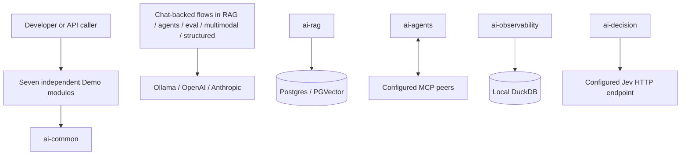

# spring-ai-apps

A multi-module Maven monorepo of Spring AI reference demos showcasing RAG, agents, evaluation, observability, multimodality, structured output, and typed decisions.

## Modules

| Module | Description |
| --- | --- |
| [`ai-common`](ai-common/README.md) | Shared infrastructure: provider-portable chat model wiring, VectorStore helpers, exceptions/error handling, and the Eval harness. |
| [`ai-rag`](ai-rag/README.md) | Retrieval-Augmented Generation with hybrid search (semantic + PostgreSQL full-text), reciprocal rank fusion, reranking, and a grounding guard. Includes a Thymeleaf chat UI. |
| [`ai-agents`](ai-agents/README.md) | Plain `@Tool` calling, optional MCP server publication and client callback seam, plus a minimal Thymeleaf chat UI. |
| [`ai-eval`](ai-eval/README.md) | In-app evaluation using the shared Eval harness: grade Q&A pairs against criteria, track history, and report regressions. |
| [`ai-observability`](ai-observability/README.md) | All-local DuckDB trace sink consuming Spring AI Micrometer observations with query endpoints. |
| [`ai-multimodal`](ai-multimodal/README.md) | All four modalities: image generation, vision, text-to-speech, and audio transcription. |
| [`ai-structured`](ai-structured/README.md) | Typed extraction to validated POJOs using Spring AI structured output and Bean Validation. |
| [`ai-decision`](ai-decision/README.md) | Typed decisions (Choice, Score, Noul) with probability fields; Jev adapter contract remains unverified upstream. |

## Quick Start

### Prerequisites

- Java 25 (Temurin)
- Maven 3.9+
- Docker (for Postgres/PGVector when running `ai-rag`)

### Build & Test

```bash
# Compile everything
mvn -DskipTests compile

# Run all tests
mvn test
```

### Provider Profiles

The six Spring AI demos default to `ollama` (zero-key local). `ai-decision` instead uses a separately configured Jev HTTP adapter. Switch chat profiles via `spring.profiles.active` or `SPRING_PROFILES_ACTIVE`:

| Profile | Models | Notes |
| --- | --- | --- |
| `ollama` (default) | Local Ollama | No API keys required. Ensure Ollama is running locally. |
| `openai` | OpenAI models | Requires `OPENAI_API_KEY`. |
| `anthropic` | Anthropic models | Requires `ANTHROPIC_API_KEY`. |

Copy `.env.example` to a git-ignored `.env` and set only the values you need. Spring Boot and Maven do not automatically read that file. Export the required variables in your shell or configure them in your IDE. Leave unused cloud keys unset: exporting an empty key can override the non-empty startup placeholder. Docker Compose's `.env` handling does not export variables to a separately launched JVM.

For local chat, run Ollama and pull `llama3.2`; RAG also needs `nomic-embed-text`. A vision request needs a vision-capable model, and the default chat model is not a guarantee of vision support. Image/audio capabilities depend on their model beans, not just the chat profile. See the module guides for limitations, including Anthropic embeddings in RAG.

### Running a Demo

```bash
# Install the shared dependency and parent POM once (repeat after shared changes)
mvn -pl ai-common -am install -DskipTests

# Start RAG infrastructure and run just its executable module
docker compose up -d
mvn -pl ai-rag spring-boot:run

# Or run another demo, on a different port if RAG is still running
mvn -pl ai-agents spring-boot:run -Dspring-boot.run.arguments=--server.port=8081
```

Use `-am` for reactor build/test/install goals. Applying `spring-boot:run` to the entire selected reactor also invokes it on the non-executable parent/shared module. Each Demo module defaults to port 8080; run one at a time or override `server.port`. For OpenAI, prefix a run command with `SPRING_PROFILES_ACTIVE=openai` and export a real `OPENAI_API_KEY`.

Each demo exposes:
- REST APIs under `/api/<module>/...`
- OpenAPI docs at `/v3/api-docs` (Swagger UI at `/swagger-ui.html` where configured)
- `GET /api/<module>/ping` for a simple module response (not a provider connectivity check)

The full test suite requires Docker for RAG's PGVector Testcontainers tests. It does not require a manually started Compose database or real AI credentials. Successful mock-backed tests verify application contracts, not live-provider compatibility.

## Architecture

- **Parent**: `spring-boot-starter-parent` 4.1.1, `spring-ai-bom` 2.0.1
- **Root package**: `dev.prasadgaikwad.springaiapps.*` (Java forbids hyphens in package names)
- **Provider portability**: Controlled via profiles; see [ADR-0001](docs/adr/0001-provider-portability-profiles-ollama-default.md)
- **Shared plumbing**: Lives in `ai-common`; see [ADR-0002](docs/adr/0002-monorepo-shared-ai-common-module.md)
- **Observability**: All-local DuckDB trace sink and Micrometer observation config live only in `ai-observability`.

## Documentation

- [CONTEXT.md](CONTEXT.md) — Domain glossary (use vocabulary verbatim)
- [docs/0001-spring-ai-apps-core-and-ai-rag-spec.md](docs/0001-spring-ai-apps-core-and-ai-rag-spec.md) — Feature specification
- [docs/adr/](docs/adr/) — Architecture Decision Records
- [Architecture and implementation map](docs/architecture.md) — System context, dependency boundaries, APIs, persistence, and testing coverage
- [Implementation learnings](docs/learnings/implementation-learnings.md) — Findings across every implemented use case
- [Documentation audit](docs/documentation-audit.md) — Sources reviewed and corrections for issue #28



The diagrams describe separate applications, not a deployed service mesh. In particular, the DuckDB handler does not automatically collect observations from other JVMs.

## License

See repository for license information.
