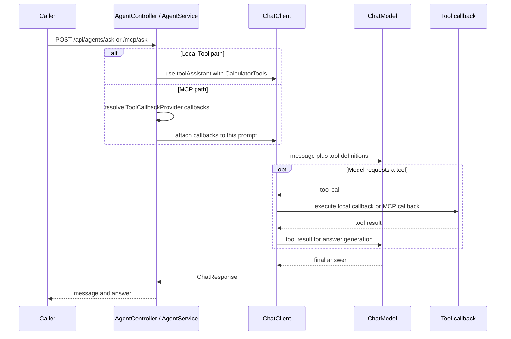

# ai-agents

Two tool-enabled chat paths: local `@Tool` methods and tools discovered through MCP. The module also defines MCP server tools and a minimal `/chat` Thymeleaf page. Package: `dev.prasadgaikwad.springaiapps.agents`.

## Run and configure

```bash
mvn -pl ai-common -am install -DskipTests
mvn -pl ai-agents spring-boot:run
```

Use a running Ollama with a tool-capable model, or select `openai` / `anthropic` with real credentials as described in the [root guide](../README.md). The default model setting is `llama3.2`; model capability and tool behavior must be checked with your chosen provider.

MCP server publication and MCP client auto-configuration are **disabled by default** (`spring.ai.mcp.server.enabled=false`, `spring.ai.mcp.client.enabled=false`). The POM includes the web MVC MCP **server** starter and the MCP **client** starter. The server defaults to `protocol: STREAMABLE` in configuration metadata, but a live peer requires explicit enablement and transport wiring. For a real client connection, enable the client and configure a supported connection (for example SSE or Streamable HTTP to the peer's MCP endpoint). This demo does not create a loopback connection by default. When `ToolCallbackProvider` beans are present, `/api/agents/mcp/ask` and `/api/agents/mcp/tools` use discovered callbacks through the existing service seam. The ping endpoint does not check provider or MCP connectivity.

## API examples

| Method/path | Behavior |
| --- | --- |
| `POST /api/agents/ask` | `{"message":"..."}` → `{"message":"...","answer":"..."}` using local tools |
| `POST /api/agents/mcp/ask` | Same shape, with discovered MCP callbacks |
| `GET /api/agents/tools` | `source` and local tool names |
| `GET /api/agents/mcp/tools` | `source` and sorted discovered MCP tool names |
| `GET /api/agents/ping` | Module response |
| `GET /chat` | Chat page |

```bash
curl -s http://localhost:8080/api/agents/tools
curl -s http://localhost:8080/api/agents/ask -H 'Content-Type: application/json' \
  -d '{"message":"Convert 10 kilometres to miles using the tool."}'
curl -s http://localhost:8080/api/agents/mcp/tools
```

OpenAPI is at `/v3/api-docs` and `/swagger-ui.html`. Blank messages produce a shared 400 error. An absent model result is rejected. No application-level conversation history is stored between requests.

## Tool ownership

| Bean | Tools | Role |
| --- | --- | --- |
| `CalculatorTools` | `add`, `multiply`, `convertUnit`, `daysBetween` | Local `@Tool` callbacks registered on `toolAssistant` |
| `KnowledgeMcpTools` | `lookupGlossary`, `currentVersion` | `@McpTool` methods published when the MCP server is enabled |

Conversion supports km↔mi and kg↔lb (including aliases); incompatible dimensions are rejected. Dates use ISO `yyyy-MM-dd` and whole signed day differences. The MCP glossary is a small fixed switch of definitions, not a dynamic reader of `CONTEXT.md`.

## Orchestration sequence



Spring AI handles the tool-call exchange. Tools are available to the model; a request does not prove a tool was invoked. The MCP path resolves an optional `ToolCallbackProvider`; with none it attaches an empty array and can still answer as ordinary chat. Multiple provider beans require unambiguous wiring (`getIfAvailable` expects a unique candidate).

## Tests and learnings

`mvn -pl ai-agents -am test` runs REST/UI context tests with a named mock `ollamaChatModel`, focused calculator tests, and `McpClientProtocolIntegrationTests`. `McpClientProtocolIntegrationTests` starts the MCP server (SSE protocol) on a random port, performs a real MCP client handshake, discovers `lookupGlossary`/`currentVersion`, invokes them over the protocol, and verifies a `SyncMcpToolCallbackProvider` exposes the discovered callbacks. Mock-backed REST tests cover the `/api/agents/mcp/*` service/controller path with configured callback providers; they do not require a live model to choose tool calls. Live peer topology and model-generated tool selection remain environment-dependent. See [implementation learnings](../docs/learnings/implementation-learnings.md).
