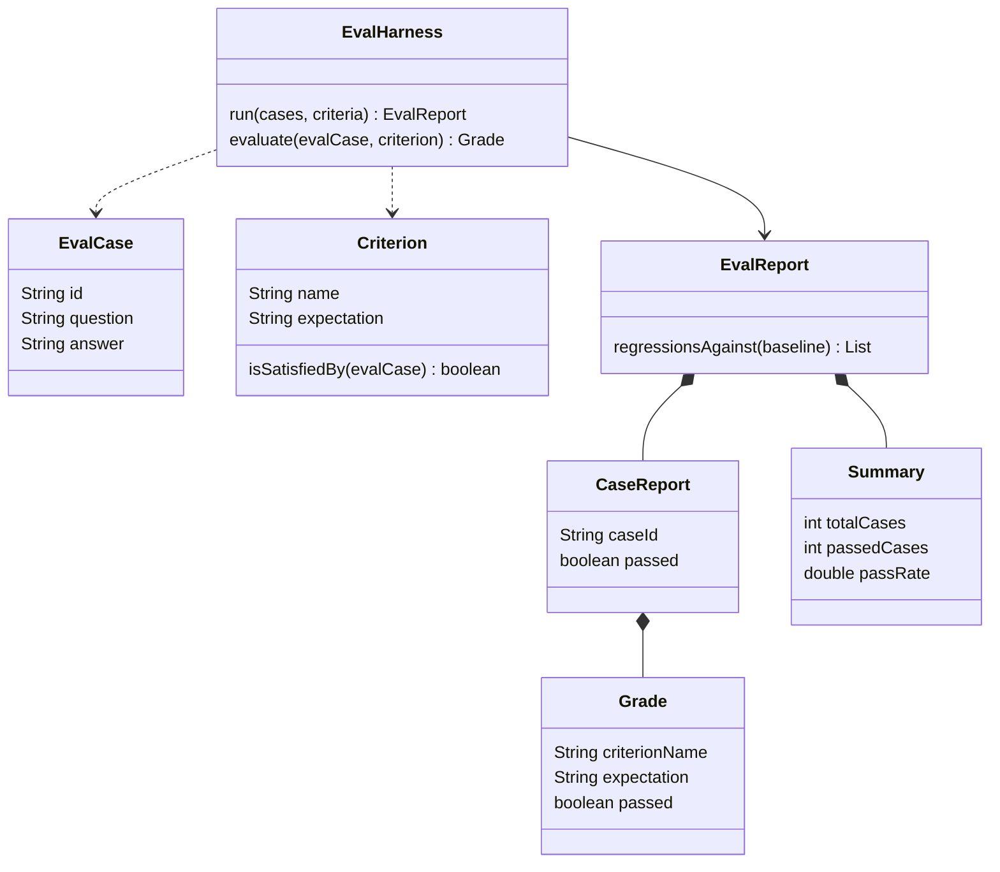

# ai-common

Shared configuration, REST errors, and the deterministic **Eval harness** used by the Demo modules. This is a dependency, not an executable application. Java package: `dev.prasadgaikwad.springaiapps.common`.

## Responsibilities and boundaries

| Component | Behavior |
| --- | --- |
| `ChatModelConfiguration` | Profile-specific `@Primary` aliases for the auto-configured `ollamaChatModel`, `openAiChatModel`, or `anthropicChatModel` |
| `VectorStoreConfiguration` | Conditional on the Vector store API; primary embedding aliases for Ollama and OpenAI only |
| `ApiExceptionHandler` | Maps `BadRequestException` to 400, `ResourceNotFoundException` to 404, and other exceptions to 500 |
| `common.eval` | Model-free criteria, grades, reports, and regression comparison |

The current POM brings the Ollama starter and web infrastructure. Cloud starters are declared by the six Spring AI Demo modules. PGVector's starter belongs only to `ai-rag`; DuckDB belongs only to `ai-observability`. Prompt templates were part of the original intended shared scope, but there is currently no shared prompt-template library. See [ADR-0002](../docs/adr/0002-monorepo-shared-ai-common-module.md).

Include `ai-common` in a Demo module's dependency list and component-scan `dev.prasadgaikwad.springaiapps.common` as well as the demo package. A dependency alone does not make sibling-package configurations discoverable.

## Eval harness example

```java
import java.util.List;
import dev.prasadgaikwad.springaiapps.common.eval.*;

var harness = new EvalHarness();
var report = harness.run(
    List.of(new EvalCase("q1", "What is Spring AI?", "Spring AI integrates AI models.")),
    List.of(Criterion.contains("Spring AI"), Criterion.excludes("guaranteed accurate")));
var passRate = report.summary().passRate();
```

`contains` takes **one** expected-text argument. Use `Criterion.of(name, expectation, predicate)` for a custom named rule; that predicate receives the whole `EvalCase`. Custom predicates stay in-process and are not exposed through `ai-eval` REST.



## Semantics that matter

- `run` requires non-empty cases and criteria, rejects duplicate case IDs, applies every criterion to every case, and preserves both input orders.
- A case ID and question must contain text; an answer may be empty but not null.
- `contains` / `excludes` ignore case. `equalsText` also trims and collapses whitespace. `matchesRegex` uses Java `find()`, is case-sensitive unless the pattern specifies flags, and compiles at criterion creation.
- A case passes only when **all** its grades pass; `CaseReport` derives this flag even if a constructor caller supplies another value.
- Harness summaries count cases and grades separately. Case pass rate is `passedCases / totalCases`. `Summary` checks count ranges and that passed + failed cases equals total; manually constructed reports do not recalculate their supplied summary.
- `regressionsAgainst` returns IDs passing in the baseline and failing now, in current-report order. New cases, removed cases, and pre-existing failures are not regressions. When comparing manually constructed baselines with duplicate IDs, the first occurrence wins.
- Custom predicate failures propagate; the harness does not turn exceptions into failed grades.

## REST error shape

The shared advice returns `CommonError` (`timestamp`, `code`, `message`, `path`). This is exception translation, not a universal validation layer: each demo performs its own checks, and the generic handler currently exposes the exception message. Avoid assuming all malformed inputs or upstream failures have a dedicated 4xx mapping.

## Verification and further reading

`mvn -pl ai-common -am test` exercises the focused harness seam (criterion semantics, report invariants, ordering, and regressions). No model calls or infrastructure are involved. [ADR-0004](../docs/adr/0004-eval-harness-in-ai-common.md) explains why this logic stays separate from answer generation and transport.
