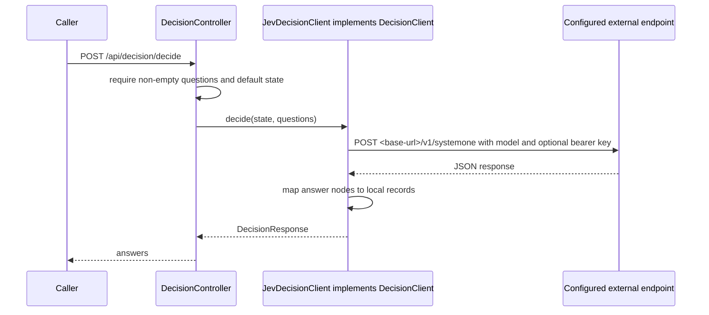
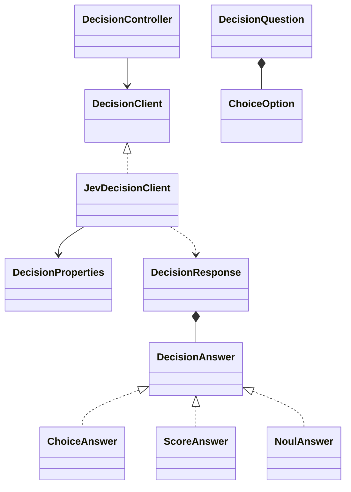

# ai-decision

A typed-decision REST adapter with a `DecisionClient` seam and `JevDecisionClient` implementation. Package: `dev.prasadgaikwad.springaiapps.decision`. This module demonstrates a separate decision API, rather than forcing typed decisions into Spring AI's `ChatModel` interface.

## Implementation status

The code implements local Choice/Score/Noul DTOs and an HTTP request/response mapping. `JevDecisionClientContractTests` verifies the adapter against a deterministic `MockWebServer`: request path/body/authorization mapping (including base-URL path preservation), documented field aliases, strict answer-identity/range checks, provider-error mapping for malformed payloads, invalid JSON, non-2xx responses, and timeouts. `DecisionControllerTests` covers REST success plus 502/504 upstream mapping with a stubbed `DecisionClient`. **The live vendor API contract, endpoint semantics, model names, and probability/Noul calibration remain unverified assumptions.** Validate them against the vendor before relying on live interoperability. Probability fields are raw provider values; the application does not calibrate them.

## Run and configuration

```bash
mvn -pl ai-common -am install -DskipTests
# Export JEV_API_KEY and any endpoint/model overrides first
mvn -pl ai-decision spring-boot:run
curl -s http://localhost:8080/api/decision/ping
```

## Spring AI 2.1 `DecisionModel` evaluation

Spring AI 2.1's standard `DecisionModel` was evaluated against this adapter. The module keeps `DecisionClient`/`JevDecisionClient`, the local Choice/Score/Noul DTOs, and `ai.decision.*` for now. The standard answer hierarchy has no Noul type; the official System One mapper turns Noul into a `YesNoAnswer` probability and drops the reason, and its Score answer is tied to ordered levels and per-level probabilities. See the [evaluation](../docs/spikes/46-decision-model-evaluation.md) and [ADR-0003](../docs/adr/0003-decision-model-integration.md).

Unlike the other six demos, there is no default `ollama` profile or cloud-profile YAML in this module. Configuration uses `ai.decision.*`:

| Property | Environment / default | Actual behavior |
| --- | --- | --- |
| `provider` | `jev` | Validated at startup; `jev` is the only supported value and does not select a bean |
| `base-url` | `JEV_BASE_URL`, `https://api.typesafe.ai` | Base URL; any path is preserved and `/v1/systemone` is appended |
| `api-key` | `JEV_API_KEY`, then `TYPESAFE_API_KEY`, then `SYSTEMONE_API_KEY` | Bearer token when non-blank; blank sends no `Authorization` header |
| `model` | `JEV_MODEL`, `jev-latest` | Sent in request body |
| `timeout` | `10s` | Positive value required; applied to HTTP connect, response, and reactive call |

Environment fallback uses Spring placeholders: an explicitly empty first variable does not fall through to the next alias. Leave unused aliases unset. There is no configured retry policy or request-size limit. See [root setup](../README.md) for exporting environment values.

## REST request and response

`POST /api/decision/decide` accepts arbitrary `state` map plus a non-empty `questions` array. Missing state becomes an empty map. `GET /api/decision/ping` returns module/status; Swagger UI is `/swagger-ui.html`.

```json
{
  "state": {"customerTier": "gold", "daysWaiting": 3},
  "questions": [{
    "id": "route",
    "type": "CHOICE",
    "prompt": "Which support queue should handle this request?",
    "choices": [{"id": "priority", "label": "Priority"}, {"id": "normal", "label": "Normal"}]
  }]
}
```

Send that JSON as the body of a decision POST. This makes an **external request**, unlike ping and invalid-input tests. Question types are enum values `CHOICE`, `SCORE`, `NOUL`; choices default to an empty immutable list. The controller rejects null state values, blank question IDs/prompts, missing types, and `CHOICE` questions without choices. The adapter additionally rejects duplicate requested question IDs. State/list copies are shallow; nested arbitrary state values are not made immutable.

The adapter posts `{model,state,questions}` to `<base-url>/v1/systemone`. It reads `answers`, falling back to `data.answers` when absent/not an array, then returns `{"answers":[...]}` containing concrete fields:

| Local answer | Fields |
| --- | --- |
| `ChoiceAnswer` | `questionId`, `selectedChoiceId`, `probability` |
| `ScoreAnswer` | `questionId`, `score`, `probability` |
| `NoulAnswer` | `questionId`, `reason`, `probability` |

Parsing accepts `id` as a question-ID fallback (non-blank required), `choiceId` as a selected-choice fallback, `confidence` as a probability fallback, and `NONE`/`NULL` as Noul aliases. Unknown/missing types, non-numeric or out-of-range values, and blank/unknown/duplicate answer IDs are provider errors. Every requested question must have exactly one answer; a genuinely empty `answers` array is accepted only when no questions were requested. Missing probabilities still default to **1.0**, and missing numeric scores default to zero. Output DTOs do not carry an explicit type discriminator. Probability values are raw provider values; their presence does not establish calibration.

Blank bodies, non-array or missing `data.answers`, invalid JSON, HTTP non-2xx responses, connect/read timeouts, and contract violations map to `UpstreamServiceException` (502) or `UpstreamTimeoutException` (504) through the shared error handler. Exception details and response bodies are not echoed to callers.

## Sequence and class relationships





All DTOs are nested in `DecisionPrimitives`. The interface is a future extension seam; there is only one component implementation today. Adding another implementation requires explicit bean selection, not merely changing `provider`.

## Tests and learnings

`./mvnw -pl ai-decision -am test` runs `JevDecisionClientContractTests` (mocked HTTP request/response mapping, aliases, validation failures, non-2xx, invalid JSON, timeout), `DecisionControllerTests` (context, ping, validation, success, 502/504 mapping with a stubbed client), `DecisionPropertiesTest` (defaults and invalid config), and `DecisionPrimitivesTest` (record fields and state copying). There is no real-provider test. The key learning is to distinguish verified adapter behavior (covered by mock contract tests) from unverified provider portability/calibration. See [ADR-0003](../docs/adr/0003-decision-model-integration.md).
