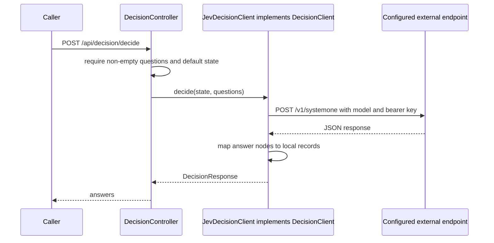
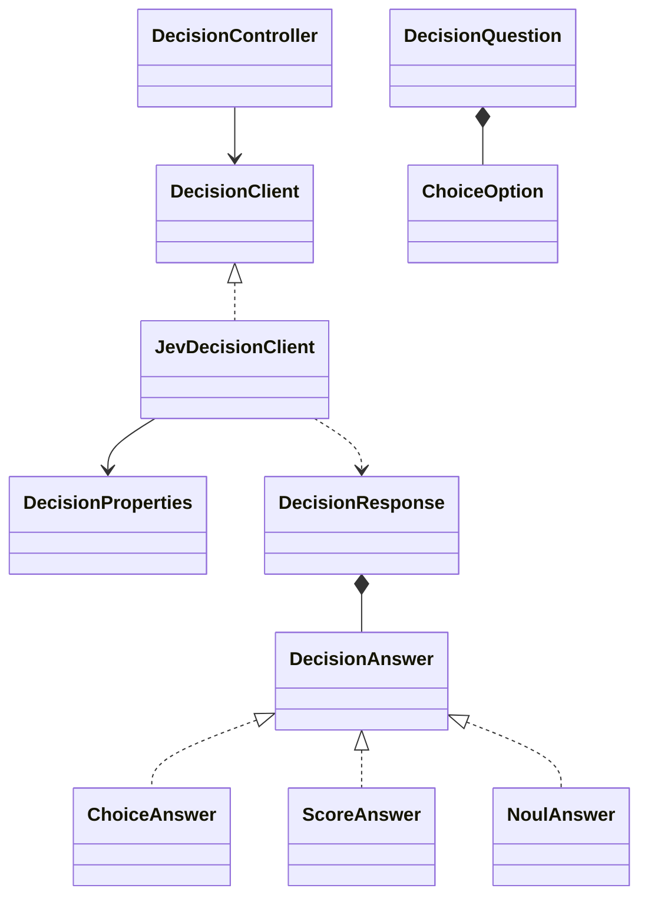

# ai-decision

A typed-decision REST adapter with a `DecisionClient` seam and `JevDecisionClient` implementation. Package: `dev.prasadgaikwad.springaiapps.decision`. This module demonstrates a separate decision API, rather than forcing typed decisions into Spring AI's `ChatModel` interface.

## Implementation status

The code implements local Choice/Score/Noul DTOs and an HTTP request/response mapping. **The current tests do not verify a successful upstream HTTP exchange or the vendor's live API contract.** The configured URL, route, model name, probability meanings, and Noul interpretation describe this adapter's assumptions. Validate them against the vendor before relying on live interoperability. The application does not calibrate or validate probabilities.

## Run and configuration

```bash
mvn -pl ai-common -am install -DskipTests
# Export JEV_API_KEY and any endpoint/model overrides first
mvn -pl ai-decision spring-boot:run
curl -s http://localhost:8080/api/decision/ping
```

Unlike the other six demos, there is no default `ollama` profile or cloud-profile YAML in this module. Configuration uses `ai.decision.*`:

| Property | Environment / default | Actual behavior |
| --- | --- | --- |
| `provider` | `jev` | Metadata only; does not select an implementation |
| `base-url` | `JEV_BASE_URL`, `https://api.typesafe.ai` | WebClient base URL |
| `api-key` | `JEV_API_KEY`, then `TYPESAFE_API_KEY`, then `SYSTEMONE_API_KEY` | Bearer token when non-blank |
| `model` | `JEV_MODEL`, `jev-latest` | Sent in request body |
| `timeout` | `10s` | Timeout on blocking for the reactive response |

Environment fallback uses Spring placeholders: an explicitly empty first variable does not fall through to the next alias. Leave unused aliases unset. There is no configured retry policy, request-size limit, or validated positive timeout. The timeout is not a separately configured HTTP connect/read timeout. See [root setup](../README.md) for exporting environment values.

## REST request and response

`POST /api/decision/decide` accepts arbitrary `state` map plus a non-empty `questions` array. Missing state becomes an empty map. `GET /api/decision/ping` returns module/status; Swagger UI is `/swagger-ui.html`.

```json
{
  "state": {"customerTier": "gold", "daysWaiting": 3},
  "questions": [{
    "id": "route",
    "type": "CHOICE",
    "prompt": "Which support queue should handle this request?",
    "choices": [{"id": "priority", "label": "Priority"}, {"id": "normal", "label": "Normal"}]
  }]
}
```

Send that JSON as the body of a decision POST. This makes an **external request**, unlike ping and invalid-input tests. Question types are enum values `CHOICE`, `SCORE`, `NOUL`; choices default to an empty immutable list. Question IDs, prompts, per-type choice constraints, and probability ranges are not deeply validated by the controller. State/list copies are shallow; nested arbitrary state values are not made immutable.

The adapter posts `{model,state,questions}` to `/v1/systemone`. It reads `answers`, falling back to `data.answers` when absent/empty, then returns `{"answers":[...]}` containing concrete fields:

| Local answer | Fields |
| --- | --- |
| `ChoiceAnswer` | `questionId`, `selectedChoiceId`, `probability` |
| `ScoreAnswer` | `questionId`, `score`, `probability` |
| `NoulAnswer` | `questionId`, `reason`, `probability` |

Parsing accepts `id` as a question-ID fallback, `choiceId` as a selected-choice fallback, `confidence` as a probability fallback, and `NONE`/`NULL` as Noul aliases. Unknown/missing types fall into Choice; missing probabilities default to **1.0**, and missing numeric scores default to zero. Empty/unrecognized answer containers return an empty list. There is no requirement that every input question has an answer, and output DTOs do not carry an explicit type discriminator. These permissive fallbacks are implementation behavior, not guarantees of valid or calibrated decisions. Upstream HTTP/timeout/parse errors reach generic error handling rather than a dedicated provider error contract.

## Sequence and class relationships





All DTOs are nested in `DecisionPrimitives`. The interface is a future extension seam; there is only one component implementation today. Adding another implementation requires explicit bean selection, not merely changing `provider`.

## Tests and learnings

`mvn -pl ai-decision -am test` runs `DecisionControllerTests` (context, ping, empty-question rejection) and `DecisionPrimitivesTest` (record fields and state copying). There is no mocked HTTP success/mapping test and no real-provider test. The key learning is to distinguish an extension interface and DTO scaffold from verified provider portability. See [ADR-0003](../docs/adr/0003-decision-model-integration.md).
