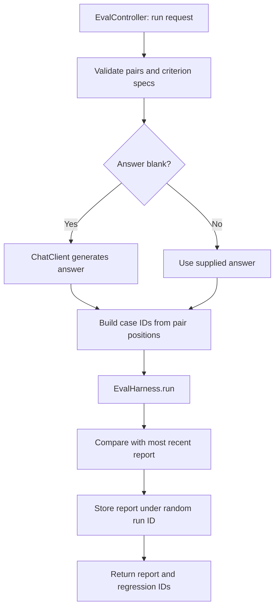

# ai-eval

REST orchestration around the shared, deterministic Eval harness: optionally generate answers, grade pairs, retain reports, and identify pass→fail regressions. Package: `dev.prasadgaikwad.springaiapps.eval`.

## Run

```bash
mvn -pl ai-common -am install -DskipTests
mvn -pl ai-eval spring-boot:run
```

See the [root setup](../README.md) for profiles and credentials. Supplied non-blank answers are graded without contacting a model; null, empty, or whitespace-only answers trigger the active ChatModel. The shared harness itself accepts empty answers, but this REST service treats them as requests for generation.

## Public contract and a deterministic example

| Method/path | Response |
| --- | --- |
| `POST /api/eval/run` | `runId`, `report` (`cases`, `summary`), `regressions` |
| `GET /api/eval/runs` | Insertion-ordered summaries: `runId`, `totalCases`, `passedCases`, `passRate` |
| `GET /api/eval/runs/{runId}` | Stored report with an empty `regressions` list |
| `GET /api/eval/ping` | Module and status |

```bash
curl -s http://localhost:8080/api/eval/run -H 'Content-Type: application/json' \
  -d '{"pairs":[{"question":"What stores embeddings?","answer":"PGVector stores embeddings."}],"criteria":[{"type":"contains","value":"PGVector"},{"type":"excludes","value":"guaranteed"}]}'
curl -s http://localhost:8080/api/eval/runs
```

Non-empty `pairs` and `criteria` are required. Every question must contain text. A criterion is `{type,value}` with one of `contains`, `excludes`, `matchesRegex`, `equalsText`; invalid types, blank values, and invalid regexes produce 400. Unknown run IDs produce 404. All criteria apply to every pair. Java custom predicates are intentionally unavailable over REST.

## Run flow



Case IDs are `case-0`, `case-1`, etc. Regression comparison uses the **most recent run**, not a user-selected baseline. Keep pair ordering and meaning stable across runs: reordering questions compares unrelated pairs at the same position. To see a regression, repeat the example with a non-blank answer that omits `PGVector`; the POST response then lists `case-0`.

History is held in an `ArrayDeque` and `LinkedHashMap`: it is process-local, unbounded, not persisted, and not concurrency-hardened. Restarting loses reports. Only the POST result carries the immediate regression diff; fetching a run does not recompute or retain that diff. Reports carry questions/grades, not generated answer text. These are reference-demo semantics, not a durable experiment-tracking service.

## Tests and further reading

`mvn -pl ai-eval -am test` verifies supplied-answer grading, generated answers, regression detection, history, and invalid requests through MockMvc with a mocked ChatModel. The shared [Eval harness guide](../ai-common/README.md) covers criterion matching, summary invariants, and report comparison. [ADR-0004](../docs/adr/0004-eval-harness-in-ai-common.md) records the model-free core boundary.
