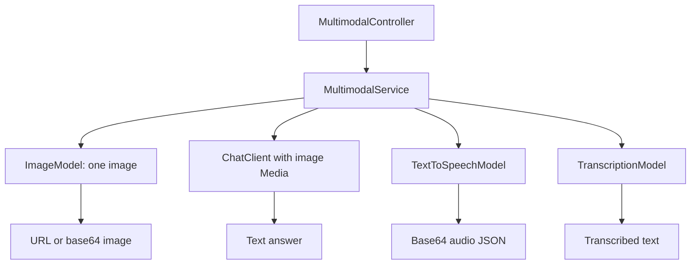

# ai-multimodal

Four independent REST flows using Spring AI image, multimodal chat, speech, and transcription interfaces. Package: `dev.prasadgaikwad.springaiapps.multimodal`.

## Run and capability selection

```bash
mvn -pl ai-common -am install -DskipTests
# After exporting a real OPENAI_API_KEY
SPRING_PROFILES_ACTIVE=openai mvn -pl ai-multimodal spring-boot:run
```

Ollama is the default chat profile, but its default `llama3.2` setting does not establish vision support. Use a vision-capable model for image questions. Ollama does not itself provide this demo's image generation, TTS, or transcription interfaces; OpenAI is the intended provider for those flows.

The image/audio dependencies are resolved through `ObjectProvider.getIfAvailable`. Missing beans produce a descriptive 400 error. **A bean's presence is not a capability or credential check**: cloud starters can auto-configure media beans even under another chat profile with placeholder keys. Consequently an Ollama/Anthropic chat profile does not automatically disable OpenAI media calls, and a request may fail upstream rather than take the missing-bean branch. There is no explicit per-profile capability registry.

## Endpoints and payloads

All POST requests use JSON; binary data uses raw base64 strings (not `data:` URLs or multipart uploads).

| Endpoint under `/api/multimodal` | Request | Response |
| --- | --- | --- |
| `/image` | `prompt`, optional `width` and `height` | `url`, `b64Json`, `revisedPrompt` |
| `/vision` | `question`, `imageBase64`, optional `mimeType` | `answer` |
| `/speech` | `text`, optional `voice` | `audioBase64`, `mimeType`, `byteLength` |
| `/transcribe` | `audioBase64`, optional `mimeType` | `text` |

`GET /api/multimodal/ping` returns module/status. Swagger UI: `/swagger-ui.html`.

```bash
curl -s http://localhost:8080/api/multimodal/image -H 'Content-Type: application/json' \
  -d '{"prompt":"A simple blue notebook on a white desk","width":1024,"height":1024}'
curl -s http://localhost:8080/api/multimodal/speech -H 'Content-Type: application/json' \
  -d '{"text":"Hello from Spring AI."}'
```

For vision send an actual encoded image, for example `{"question":"What is visible?","imageBase64":"<base64 bytes>","mimeType":"image/png"}`; replace the placeholder before calling. Vision defaults the MIME type to `image/png` and rejects invalid MIME/base64 input. Transcription also decodes base64.

## Request routing



Implementation details worth preserving:

- Image dimensions are applied only when **both** are provided; one image is requested. `revisedPrompt` is currently always null.
- Vision sends a `UserMessage` with `Media` built from decoded bytes and asks for a short grounded description.
- Speech currently ignores the request's `voice`; it uses provider defaults and labels the result `audio/mpeg` without inspecting the bytes.
- Transcription currently ignores the request's `mimeType`; the resource is a `ByteArrayResource` without an explicit filename.
- Empty model output is rejected. Vision wraps provider exceptions as 400; image/speech/transcription failures are not all normalized the same way and may reach the generic 500 advice.

## Verification and learnings

`mvn -pl ai-multimodal -am test` uses mocked chat/image/speech/transcription models to exercise all four REST contracts and invalid requests. This does not verify live codecs, provider-supported dimensions, voice options, or actual vision quality. The central learning is that provider portability is capability-specific: switching the primary ChatModel does not switch every model interface. See [architecture](../docs/architecture.md) and [implementation learnings](../docs/learnings/implementation-learnings.md).
