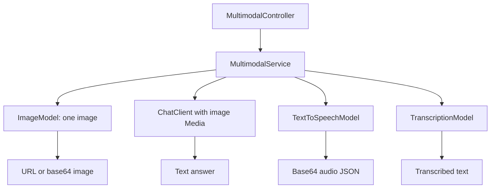

# ai-multimodal

Four independent REST flows using Spring AI image, multimodal chat, speech, and transcription interfaces. Package: `dev.prasadgaikwad.springaiapps.multimodal`.

## Run and capability selection

```bash
mvn -pl ai-common -am install -DskipTests
# After exporting a real OPENAI_API_KEY
SPRING_PROFILES_ACTIVE=openai mvn -pl ai-multimodal spring-boot:run
```

Ollama is the default chat profile, but its default `llama3.2` setting does not establish vision support. Use a vision-capable model for image questions. Ollama does not itself provide this demo's image generation, TTS, or transcription interfaces; OpenAI is the intended provider for those flows.

The image/audio dependencies are resolved through `ObjectProvider.getIfAvailable`. Missing beans produce a descriptive 400 error. **A bean's presence is not a capability or credential check**: cloud starters can auto-configure media beans even under another chat profile with placeholder keys. Consequently an Ollama/Anthropic chat profile does not automatically disable OpenAI media calls, and a request may fail upstream rather than take the missing-bean branch. There is no explicit per-profile capability registry.

## Endpoints and payloads

All POST requests use JSON; binary data uses raw base64 strings (not `data:` URLs or multipart uploads).

| Endpoint under `/api/multimodal` | Request | Response |
| --- | --- | --- |
| `/image` | `prompt`, optional `width` and `height` | `url`, `b64Json`, `revisedPrompt` |
| `/vision` | `question`, `imageBase64`, optional `mimeType` | `answer` |
| `/speech` | `text`, optional `voice`, `format`, `speed` | `audioBase64`, `mimeType`, `byteLength` |
| `/transcribe` | `audioBase64`, optional `mimeType` | `text` |

`GET /api/multimodal/ping` returns module/status. Swagger UI: `/swagger-ui.html`.

```bash
curl -s http://localhost:8080/api/multimodal/image -H 'Content-Type: application/json' \
  -d '{"prompt":"A simple blue notebook on a white desk","width":1024,"height":1024}'
curl -s http://localhost:8080/api/multimodal/speech -H 'Content-Type: application/json' \
  -d '{"text":"Hello from Spring AI.","voice":"alloy","format":"wav","speed":1.1}'
```

For vision send an actual encoded image, for example `{"question":"What is visible?","imageBase64":"<base64 bytes>","mimeType":"image/png"}`; replace the placeholder before calling. Vision defaults the MIME type to `image/png`, rejects non-image MIME types, and rejects invalid base64. Transcription also decodes base64. Its `mimeType` defaults to `audio/mpeg` and must be an audio type; the subtype selects the resource filename extension (`mpeg`/`mp3` → `.mp3`, `wav` → `.wav`, `mp4`/`m4a` → `.m4a`, `ogg`/`opus` → `.ogg`, `flac` → `.flac`, `webm` → `.webm`, `aac` → `.aac`). Unsupported audio subtypes are rejected with 400.

## Request routing



Implementation details worth preserving:

- Image dimensions are applied independently when present; each must be positive. One image is requested. `revisedPrompt` is populated when the provider metadata exposes it (OpenAI's image metadata); it remains null for providers that do not.
- Vision sends a `UserMessage` with `Media` built from decoded bytes and asks for a short grounded description. A provided `mimeType` must be an image type; it defaults to `image/png`.
- Speech forwards `voice`, `format`, and `speed` as `TextToSpeechOptions`; `format` is lower-cased and `speed` must be positive. The response `mimeType` is derived from the requested format (`mp3`/`mpeg` → `audio/mpeg`, `wav` → `audio/wav`, `opus`/`ogg` → `audio/ogg`, `flac` → `audio/flac`, `pcm` → `audio/L16`, `webm` → `audio/webm`, `aac` → `audio/aac`; no format defaults to `audio/mpeg`). It is a label, not byte sniffing; provider support for a codec or voice remains provider-specific.
- Transcription wraps decoded bytes in a resource whose filename extension is derived from `mimeType`, so providers that inspect filenames can identify the format (the OpenAI model does). Unsupported audio subtypes are rejected before the model call.
- Empty model output is rejected. Vision wraps provider exceptions as 400; image/speech/transcription failures are not all normalized the same way and may reach the generic 500 advice.

## Verification and learnings

`mvn -pl ai-multimodal -am test` uses mocked chat/image/speech/transcription models to exercise all four REST contracts, option mapping (image dimensions, speech voice/format/speed, MIME-derived transcription filenames), revised-prompt metadata, and invalid input. This does not verify live codecs, provider-supported dimensions/voices/formats, or actual vision quality. The central learning is that provider portability is capability-specific: switching the primary ChatModel does not switch every model interface. See [architecture](../docs/architecture.md) and [implementation learnings](../docs/learnings/implementation-learnings.md).
