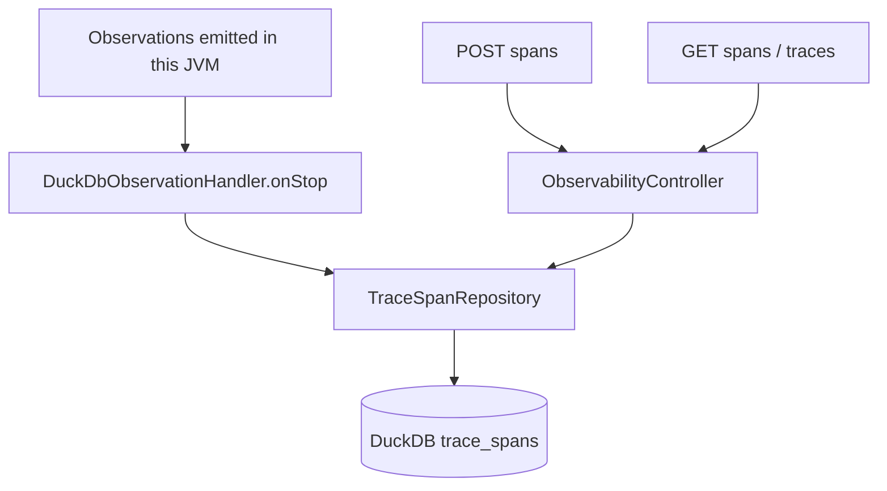
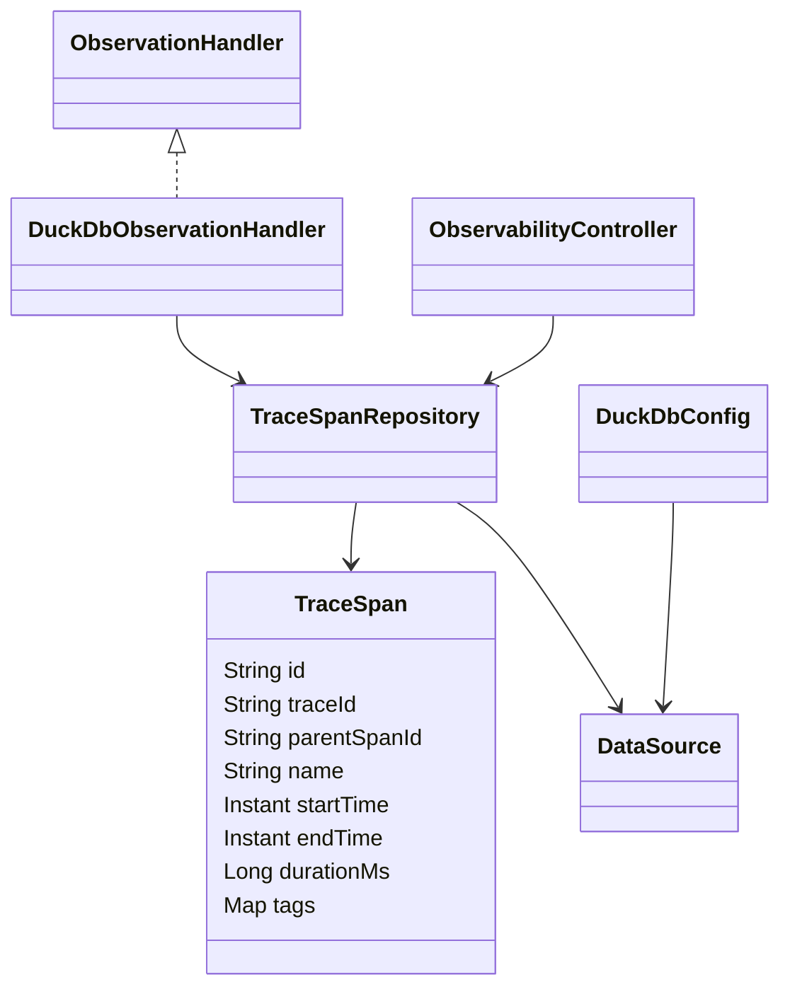

# ai-observability

An embedded DuckDB sink for Micrometer observations in this application, plus REST insertion and queries. Package: `dev.prasadgaikwad.springaiapps.observability`. All sink configuration and persistence code remain local to this Demo module.

## Run and storage

```bash
mvn -pl ai-common -am install -DskipTests
mvn -pl ai-observability spring-boot:run
```

No external database is needed. `trace.duckdb.url` defaults to `jdbc:duckdb:./data/ai-observability-traces.duckdb`; the path is relative to the application's working directory. `DuckDbConfig` creates parent directories and initializes `trace_spans` plus indexes on `trace_id`, `name`, and `start_time`. Override the property (or `TRACE_DUCKDB_URL`) to choose a different file. File-backed storage survives restart; there is no retention job or migration framework.

The six-demo chat-profile configuration is present, but these span APIs do not themselves invoke a ChatModel. The POM includes Actuator and Micrometer tracing APIs; YAML exposes health/info/metrics/traces and sets tracing sampling to 1.0. Health/info/metrics are available under `/actuator`; listing `traces` in the exposure configuration does not create a trace-query endpoint or install a tracing bridge. Use the module's explicit span/trace REST contract below for stored observations.

## Public API

| Method/path | Behavior |
| --- | --- |
| `POST /api/observability/spans` | Record a span; requires non-blank `traceId` and `name` |
| `GET /api/observability/spans` | Optional exact `traceId`, case-insensitive substring `name`; default `limit=100` |
| `GET /api/observability/traces` | Group by trace ID; default `limit=50` |
| `GET /api/observability/ping` | Module/status |

```bash
curl -s http://localhost:8080/api/observability/spans -H 'Content-Type: application/json' \
  -d '{"traceId":"example-trace","name":"manual.chat","kind":"CLIENT","startTime":"2026-11-01T12:00:00Z","endTime":"2026-11-01T12:00:01Z","tags":{"model":"example"}}'
curl -s 'http://localhost:8080/api/observability/spans?traceId=example-trace&name=chat&limit=10'
curl -s http://localhost:8080/api/observability/traces
```

Optional insertion fields are `parentSpanId`, `kind`, ISO-8601 `startTime` / `endTime`, and string-valued `tags`. Missing start/end times default to current time; missing tags become empty. Limits clamp to 1–500. Spans sort by start time **ascending**, so a limited query returns the earliest matching spans, not the latest. Trace summaries sort by aggregated minimum start time descending and contain `traceId`, `startTime`, `endTime`, `spanCount`, `names`.

## Capture and query architecture





`supportsContext` returns true, so the handler accepts all observations offered by this application's registry, including Spring AI operations and ordinary application observations. On stop it copies all key/value tags and adds the error class name when present. Writes are synchronous JDBC calls. Each save generates a fresh row UUID, sets service name `ai-observability`, stores tags as JSON, and clamps computed duration to non-negative milliseconds.

## Current limitations: observations are not distributed traces

The handler currently uses the **observation name** as `traceId` (random only when absent) and the parent's observation name as `parentSpanId`. These are not propagated tracing IDs or references to stored row IDs. It records both timestamps at stop rather than capturing the actual start, so durations from automatic capture do not measure operation latency. Repository status is always `OK` even when tags include an error. Repeated operation names group together in `/traces`.

The module does not automatically ingest spans from other Demo-module JVMs and is not an OpenTelemetry collector. Manual POST supports a caller-chosen trace ID and real timestamps; automatic correlation, timing, retention, and cross-process export remain gaps. [ADR-0005](../docs/adr/0005-all-local-observability-in-ai-observability-only.md) records the local-sink decision separately from these implementation limitations.

## Tests and learnings

`mvn -pl ai-observability -am test` covers manual REST insert/query, required fields, tag serialization/immutability, and context loading using DuckDB. It does not establish real distributed correlation or automatic latency accuracy. See [implementation learnings](../docs/learnings/implementation-learnings.md).
