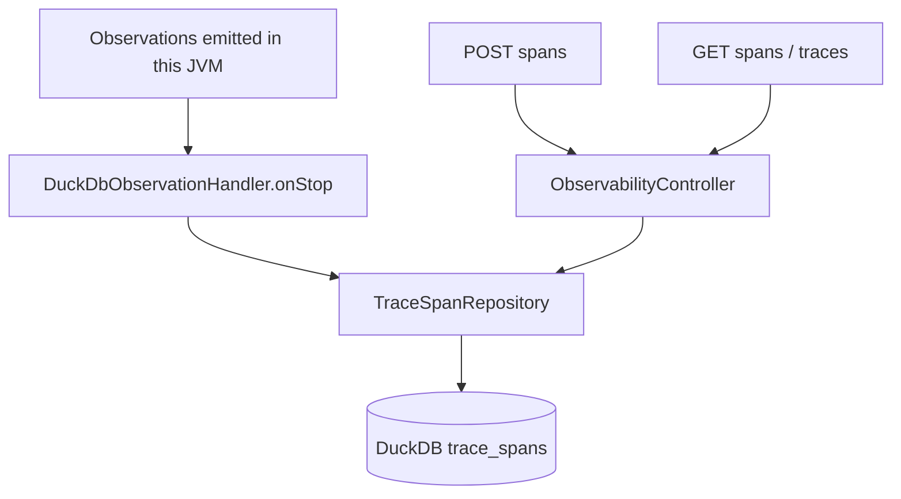
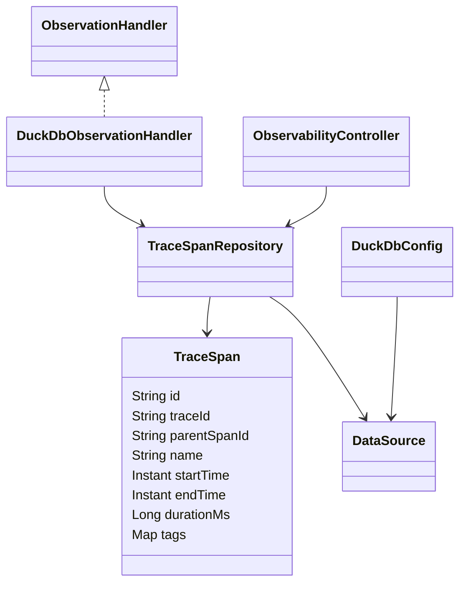

# ai-observability

An embedded DuckDB sink for Micrometer observations in this application, plus REST insertion and queries. Package: `dev.prasadgaikwad.springaiapps.observability`. All sink configuration and persistence code remain local to this Demo module.

## Run and storage

```bash
mvn -pl ai-common -am install -DskipTests
mvn -pl ai-observability spring-boot:run
```

No external database is needed. `trace.duckdb.url` defaults to `jdbc:duckdb:./data/ai-observability-traces.duckdb`; the path is relative to the application's working directory. `DuckDbConfig` creates parent directories and initializes `trace_spans` plus indexes on `trace_id`, `name`, and `start_time`. Override the property (or `TRACE_DUCKDB_URL`) to choose a different file. File-backed storage survives restart; there is no retention job or migration framework.

The six-demo chat-profile configuration is present, but these span APIs do not themselves invoke a ChatModel. The POM includes Actuator and Micrometer tracing APIs; YAML exposes health/info/metrics/traces and sets tracing sampling to 1.0. Health/info/metrics are available under `/actuator`; listing `traces` in the exposure configuration does not create a trace-query endpoint or install a tracing bridge. Use the module's explicit span/trace REST contract below for stored observations.

## Public API

| Method/path | Behavior |
| --- | --- |
| `POST /api/observability/spans` | Record a span; requires non-blank `traceId` and `name` |
| `GET /api/observability/spans` | Optional exact `traceId`, case-insensitive substring `name`; default `limit=100` |
| `GET /api/observability/traces` | Group by trace ID; default `limit=50` |
| `GET /api/observability/ping` | Module/status |

```bash
curl -s http://localhost:8080/api/observability/spans -H 'Content-Type: application/json' \
  -d '{"traceId":"example-trace","name":"manual.chat","kind":"CLIENT","startTime":"2026-11-01T12:00:00Z","endTime":"2026-11-01T12:00:01Z","tags":{"model":"example"}}'
curl -s 'http://localhost:8080/api/observability/spans?traceId=example-trace&name=chat&limit=10'
curl -s http://localhost:8080/api/observability/traces
```

Optional insertion fields are `parentSpanId`, `kind`, ISO-8601 `startTime` / `endTime`, and string-valued `tags`. Missing start/end times default to current time; missing tags become empty. Limits clamp to 1–500. Spans sort by start time **ascending**, so a limited query returns the earliest matching spans, not the latest. Trace summaries sort by aggregated minimum start time descending and contain `traceId`, `startTime`, `endTime`, `spanCount`, `names`.

## Capture and query architecture





`supportsContext` returns true, so the handler accepts all observations offered by this application's registry, including Spring AI operations and ordinary application observations. On stop it copies all key/value tags and adds the error class name when present. Writes are synchronous JDBC calls. Each save generates a fresh row UUID, sets service name `ai-observability`, stores tags as JSON, and clamps computed duration to non-negative milliseconds.

## Correlation and timing semantics

Automatic capture assigns a generated UUID span ID to every started observation and records the actual `onStart` time. The first observed span in a chain starts a generated trace ID; descendants inherit the nearest observed ancestor's trace ID and store that ancestor's span ID as `parentSpanId`. Each span is stored under its assigned span ID, so parent references point at real rows.

If a parent was never observed/started, the child starts a new trace. If an observation stops without a corresponding start, the handler still stores it with a generated identity and a zero-length interval. Error-bearing observations store status `ERROR` and an `error` tag with the exception class; successful observations store `OK`. Manual POST spans keep their caller-chosen trace IDs and timestamps and are stored as `OK`.

This is **in-process observation correlation, not distributed tracing**. Micrometer Tracing span IDs require a tracer bridge (for example Brave or OpenTelemetry); this module intentionally avoids adding that dependency, so correlation is derived from observation parent links instead. IDs are not W3C trace-context IDs and are not propagated to other Demo JVMs. The module is not an OpenTelemetry collector and does not export spans. Manual POST remains the way to inject spans with external trace IDs. Persistence is synchronous; there is no retention or migration system. [ADR-0005](../docs/adr/0005-all-local-observability-in-ai-observability-only.md) records the local-sink decision separately from these implementation limits.

## Tests and learnings

`mvn -pl ai-observability -am test` covers manual REST insert/query, required fields, tag serialization/immutability, context loading using DuckDB, and automatic handler parent/child correlation, start-to-stop timing, and error status. It does not establish distributed trace-context propagation or cross-process collection. See [implementation learnings](../docs/learnings/implementation-learnings.md).
