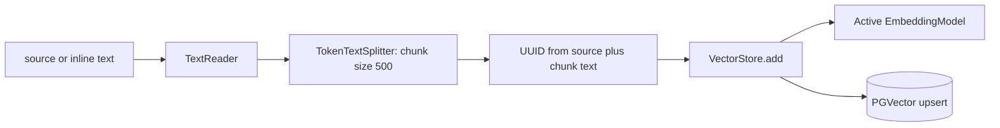
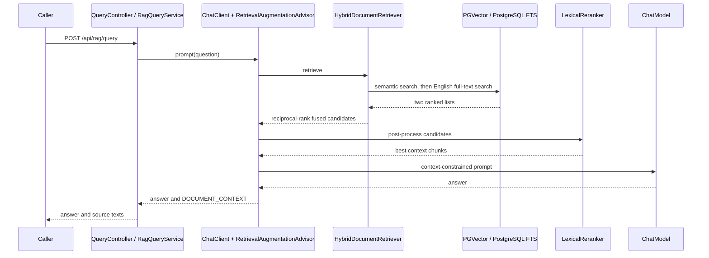

# ai-rag

Document ingestion and grounded question answering over Postgres/PGVector, with hybrid search and a minimal Thymeleaf `/chat` page. Package: `dev.prasadgaikwad.springaiapps.rag`.

## Run

From the monorepo root, with Java 25, Maven, Docker, and Ollama available:

```bash
mvn -pl ai-common -am install -DskipTests
docker compose up -d
ollama pull llama3.2
ollama pull nomic-embed-text
mvn -pl ai-rag spring-boot:run
```

Ollama must be running. Compose starts `pgvector/pgvector:pg16` on localhost:5432, database `spring_ai_pgvector`, user/password `postgres`, and persists it in `pgvector-data`. See the [root guide](../README.md) for exporting environment variables and changing ports. Open `/chat` for UI or `/swagger-ui.html` for the API.

## Public contract

| Method/path | Input | Output |
| --- | --- | --- |
| `POST /api/rag/ingest` | `source` resource location or inline `text` | `source`, document/chunk counts, `status` |
| `POST /api/rag/query` | Non-blank `question` | `question`, `answer`, `sources` (`id`, `text`), `status` |
| `GET /api/rag/ping` | None | Module and status |
| `GET /chat` | None | Thymeleaf page |

```bash
curl -s http://localhost:8080/api/rag/ingest -H 'Content-Type: application/json' \
  -d '{"text":"Spring AI integrates model providers. This reference stores document embeddings in PGVector."}'
curl -s http://localhost:8080/api/rag/query -H 'Content-Type: application/json' \
  -d '{"question":"Where does this reference store embeddings?"}'
# Or ingest the bundled text/Markdown resource
curl -s http://localhost:8080/api/rag/ingest -H 'Content-Type: application/json' \
  -d '{"source":"classpath:samples/rag-overview.md"}'
```

Inline text wins when supplied. Resource input uses Spring `ResourceLoader` and `TextReader`; this is text ingestion, not a PDF/OCR pipeline or multipart upload.

## Ingestion flow



Chunk IDs use `UUID.nameUUIDFromBytes(source + "::" + text)`. Re-ingesting identical content from the same source upserts the same rows. Changed chunks get new IDs: ingestion does **not** delete obsolete chunks from earlier source versions. All inline input shares the `inline-text` source description.

## Query sequence and grounding



`HybridDocumentRetriever` queries both legs sequentially, deduplicates by document ID, and scores each contribution as `1 / (60 + one-based rank)`. It retains semantic-first order on tied fused scores and preserves semantic metadata when both legs find the same chunk. Keyword retrieval reads `content` directly from the configured PGVector table with English `to_tsvector` / `plainto_tsquery`; it is intentionally coupled to that schema.

`LexicalReranker` then scores query-term coverage and limits the context; it is deterministic, not a learned cross-encoder. The advisor's default augmenter instructs the model to use context and admit missing answers. Grounding is a prompt-level constraint and an observable source list, not a factuality guarantee or a separate verification model. The UI calls the same query API.

## Configuration and Provider choice

| Property / environment | Default | Effect |
| --- | --- | --- |
| `OLLAMA_CHAT_MODEL` | `llama3.2` | Local answer generation |
| `OLLAMA_EMBEDDING_MODEL` | `nomic-embed-text` | Local embeddings |
| `spring.ai.vectorstore.pgvector.dimensions` | `768` | Stored vector size |
| `spring.ai.vectorstore.pgvector.index-type` | `HNSW` | Vector index |
| `spring.ai.vectorstore.pgvector.initialize-schema` | `true` | Initialize schema on startup |
| `spring.ai.vectorstore.pgvector.table-name` | `vector_store` (code fallback) | Shared semantic/keyword table |
| `spring.ai.rag.retrieval.top-k` | `10` | Per-leg candidates and fused result cap |
| `spring.ai.rag.rerank.max-documents` | `5` | Final context cap |
| `SPRING_DATASOURCE_URL/USERNAME/PASSWORD` | Compose values above | Postgres connection |

The `openai` profile selects OpenAI chat and embedding aliases. Its default embedding model is `text-embedding-3-small`; align stored dimensions with the actual embedding output and rebuild/use a fresh table before re-ingestion. A profile switch alone does not migrate existing vectors. The `anthropic` profile selects chat but has **no primary embedding alias** in shared configuration; a complete Anthropic-backed RAG setup needs an explicitly selected compatible embedding model. Do not assume all three profiles are turnkey RAG configurations. See [ADR-0001](../docs/adr/0001-provider-portability-profiles-ollama-default.md) and [ADR-0006](../docs/adr/0006-hybrid-rag-retrieval.md).

## Tests and learnings

`mvn -pl ai-rag -am test` requires Docker. `DocumentIngestionIntegrationTests` and `RagQueryIntegrationTests` use a real PGVector Testcontainer and fixed 768-dimensional embeddings; the query tests additionally mock the ChatModel. The application/UI smoke test excludes database auto-configuration and substitutes pipeline services. These verify ETL/query contracts and source propagation, not real embedding relevance or live model truthfulness. Deterministic IDs, schema coupling, and embedding migrations are covered in [implementation learnings](../docs/learnings/implementation-learnings.md).
