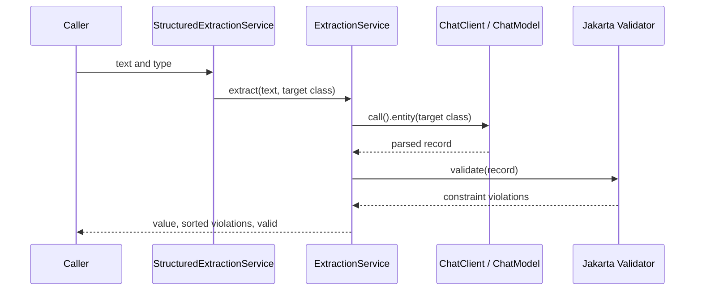
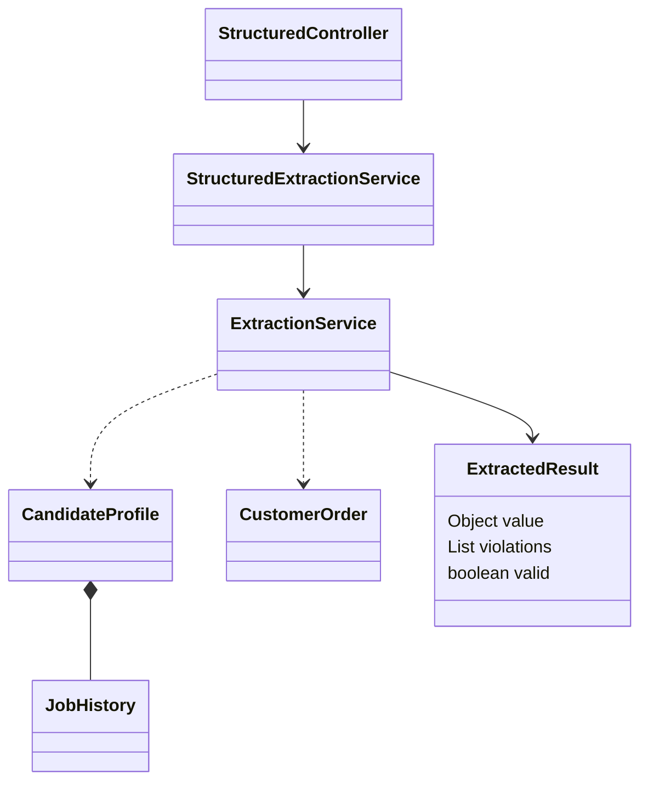

# ai-structured

Convert unstructured text to Java records, then validate the result independently of JSON parsing. Package: `dev.prasadgaikwad.springaiapps.structured`.

## Run and API

```bash
mvn -pl ai-common -am install -DskipTests
mvn -pl ai-structured spring-boot:run
curl -s http://localhost:8080/api/structured/extract -H 'Content-Type: application/json' \
  -d '{"type":"order","text":"Ada Lovelace orders 2 notebooks shipped to 10 Example Street. Note: blue covers."}'
```

Use the [root guide](../README.md) to configure Ollama (default), OpenAI, or Anthropic. `POST /api/structured/extract` accepts `{text,type}`. `GET /api/structured/ping` is retained; OpenAPI/Swagger use `/v3/api-docs` and `/swagger-ui.html`.

## Extraction targets and response

| `type` | Target record | Validation highlights |
| --- | --- | --- |
| `candidate` | `CandidateProfile` | Non-blank name, valid non-blank email, role, experience 0–60, non-empty skills; nested job history constraints |
| `order` | `CustomerOrder` | Customer name, product, shipping address required; quantity 1–1000; note entries non-blank |

The candidate also has `topSkills` and `history` (each job has `company`, `title`, `startYear`, `endYear`). The order has one `product`/`quantity`, not a line-item collection. Check the source records for exact JSON fields before constructing downstream integrations.

Response: `{"value":{...},"violations":["property: message"],"valid":true|false}`. Parseable but constraint-invalid output remains **HTTP 200** with `valid=false` and sorted violations. Unknown types, blank text, absent results, and model conversion failures are translated to 400. Matching `type` is case-sensitive. Validation checks declared constraints; it does not establish that extracted facts match the source.

## Sequence and types





`entity(Class)` asks Spring AI to convert structured model output; it does not imply every provider supports native strict JSON schema. The system prompt asks the model not to invent facts and to leave absent fields empty. Such empty required fields may correctly yield validation failures. There is no automatic repair/retry loop.

## Verification and learnings

`mvn -pl ai-structured -am test` covers REST conversion/validation with a mocked ChatModel, invalid text/type handling, direct record constraints, and context loading. The key lesson is to keep parsing success separate from domain validity; provider output can be valid JSON and still violate constraints. See [ADR-0007](../docs/adr/0007-structured-output-validation.md).
