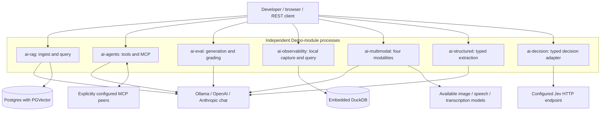
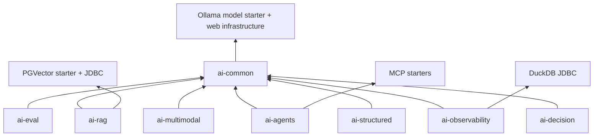
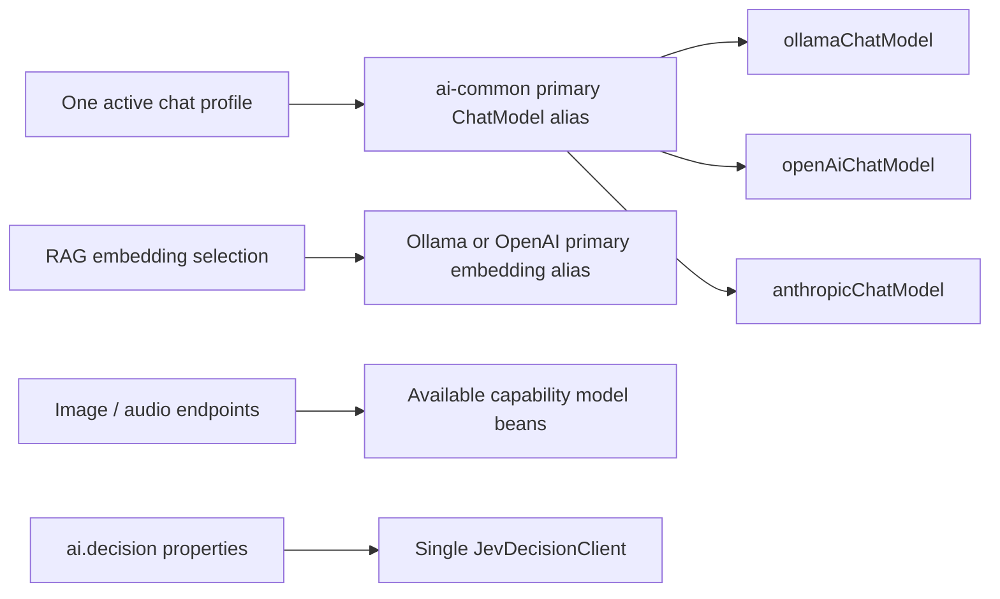

# Current architecture and implementation map

This document describes the checked-in implementation for issue #28. The [original specification](0001-spring-ai-apps-core-and-ai-rag-spec.md) records the foundation milestone; module guides describe current payloads, defaults, examples, and limits. “Implemented” below means a code path exists, not that a live external provider has been verified.

## 1. System context

The reactor builds one shared library and seven independent Spring Boot applications. Each application owns its HTTP surface and starts on port 8080 unless overridden. They are not automatically connected to each other. Only RAG and agents have a browser chat page.

An observation in RAG's process does not automatically reach observability's DuckDB. An MCP server definition does not automatically create a client connection; the current agents POM has no MCP client starter. The MCP peer edge represents the intended integration through the callback seam once configured, not a default connection. Decision endpoint compatibility remains an unverified adapter assumption.

## 2. Build-time dependencies and ownership

The parent pins Boot 4.1.2, Spring AI 2.0.2, Java 25, Springdoc 3.2.0, and Testcontainers 2.0.3. Java packages use `dev.prasadgaikwad.springaiapps`; Maven coordinates use `dev.prasadgaikwad.spring-ai-apps`.

Shared code is configuration/error translation and `common.eval`, not a shared persistence or business-service layer. Six Spring AI demos declare cloud starters; `ai-decision` uses WebClient and separate configuration. Shared configuration is discovered through the demo's component scan. No shared prompt-template library currently exists despite the original intended scope.

## 3. Provider selection is capability-specific

Only the branch for the active chat profile is primary. Other starters can still construct unused beans; placeholders avoid startup key validation but cannot authorize real requests. Use one chat profile at a time. Media resolution is by interface bean availability rather than chat-profile dispatch. Embedding compatibility is a persisted-data constraint, including model and vector dimensions; Anthropic has no shared primary embedding alias. The decision `provider` string is not a dispatch mechanism. See [ADR-0001](adr/0001-provider-portability-profiles-ollama-default.md).

## 4. Implemented use cases

| Module | Main entry / collaborators | Data and behavior | Detailed guide |
| --- | --- | --- | --- |
| ai-common | Config aliases, `ApiExceptionHandler`, `EvalHarness` | Pure criteria/reports; no model calls inside harness | [Guide](../ai-common/README.md) |
| ai-rag | `IngestController`, `QueryController`, `DocumentIngestionService`, `RagQueryService`, `RagConfig` | Text → chunks → embeddings → PGVector; hybrid retrieve → lexical rerank → advisor prompt → answer/sources | [Guide and sequences](../ai-rag/README.md) |
| ai-agents | `AgentController`, `AgentService`, `AgentConfiguration` | Separate local-tool and optional-MCP callback paths; server starter present, client integration not supplied | [Guide and sequence](../ai-agents/README.md) |
| ai-eval | `EvalController`, `EvalRunService` | Optional generation; harness report; compare latest baseline; process-local history | [Guide and flow](../ai-eval/README.md) |
| ai-observability | `ObservabilityController`, `DuckDbObservationHandler`, `TraceSpanRepository` | In-process observations/manual spans to embedded DuckDB; filtered queries | [Guide and class diagram](../ai-observability/README.md) |
| ai-multimodal | `MultimodalController`, `MultimodalService` | Image model, chat with image media, TTS bytes, transcription bytes | [Guide and flow](../ai-multimodal/README.md) |
| ai-structured | `StructuredController`, `StructuredExtractionService`, `ExtractionService` | Select target → entity conversion → Jakarta validation → value/violations | [Guide and types](../ai-structured/README.md) |
| ai-decision | `DecisionController`, `DecisionClient`, `JevDecisionClient` | Map state/questions to HTTP JSON and permissively parse typed answers | [Guide and types](../ai-decision/README.md) |

## 5. API inventory and errors

All seven demos have `GET /api/<name>/ping`, `/v3/api-docs`, and Swagger UI (`/swagger-ui.html`, including Springdoc defaults where no explicit property is present). Ping is not readiness for a database or provider. Prefixes use `rag`, `agents`, `eval`, `observability`, `multimodal`, `structured`, `decision` (not the Maven `ai-` prefix).

| Prefix | Feature routes |
| --- | --- |
| `/api/rag` | `POST /ingest`, `POST /query` |
| `/api/agents` | `POST /ask`, `POST /mcp/ask`, `GET /tools`, `GET /mcp/tools` |
| `/api/eval` | `POST /run`, `GET /runs`, `GET /runs/{runId}` |
| `/api/observability` | `POST /spans`, `GET /spans`, `GET /traces` |
| `/api/multimodal` | `POST /image`, `POST /vision`, `POST /speech`, `POST /transcribe` |
| `/api/structured` | `POST /extract` |
| `/api/decision` | `POST /decide` |

UI `/chat` belongs independently to RAG and agents and calls the respective feature API. There is no `/api/agents/chat` route.

`ApiExceptionHandler` translates explicit `BadRequestException` (400), `ResourceNotFoundException` (404), and generic exceptions (500) to `CommonError(timestamp,code,message,path)`. Validation is implemented by each use case; malformed JSON, invalid types, and provider failures are not uniformly classified by a comprehensive error taxonomy. The generic handler returns exception messages. Structured domain violations intentionally return a successful conversion response with `valid=false`, not a transport error.

## 6. Persistence and lifecycle

| Data | Storage | Lifecycle / constraints |
| --- | --- | --- |
| RAG chunks and vectors | PGVector, default `vector_store` table | Compose volume persists; deterministic IDs upsert identical chunks; no obsolete-chunk deletion |
| RAG keyword index expression | SQL over PGVector `content` | English full-text semantics; same table, no separate search service |
| Eval history | `ArrayDeque` / `LinkedHashMap` | Restart loses data; no cap or synchronization; case IDs depend on pair position |
| Observation spans | DuckDB `trace_spans` | File persists; no retention/migrations; generated row UUIDs; name-based automatic correlation |
| Agent conversations | No application conversation store | Each request is independent |
| Structured/media/decision results | Returned by request | No application persistence implemented |

The shared Eval harness creates immutable list copies and deterministic grades; model generation and external I/O remain in Demo services. Decision state copies are shallow; arbitrary nested values remain caller-owned objects.

## 7. Verification matrix

| Module | Existing default checks | What those checks do not establish |
| --- | --- | --- |
| ai-common | Criterion/report/harness unit tests | Semantic quality of arbitrary custom criteria |
| ai-rag | Real PGVector Testcontainers ETL/query tests with fixed embeddings and mock chat; separate DB-free smoke/UI tests | Real embedding relevance, live model grounding quality |
| ai-agents | Mock-backed REST/catalog tests; local calculator tests; context/UI | Live MCP handshake, actual provider tool-call execution |
| ai-eval | Mock-backed grading/generation/history/regression REST tests | Durable/concurrent experiment tracking or model-quality metrics |
| ai-observability | DuckDB insert/query REST and tag/record tests; context | Distributed identity propagation or true automatic durations |
| ai-multimodal | Mock-backed contracts for all four modalities and invalid input | Codec compatibility, live vision quality, real media-provider options |
| ai-structured | Mock-backed REST conversion/validation; record constraints; context | Factual extraction accuracy or every provider's strict-schema support |
| ai-decision | DTO fields/state copy; context/ping/empty questions | Upstream success, HTTP mapping, timeout/error behavior, calibrated probabilities |

Run `mvn test` for the whole reactor; Docker is required for RAG Testcontainers. They provision their own database rather than using Compose. Named ChatModel mocks should stub `getOptions()` before constructing clients. See [implementation learnings](learnings/implementation-learnings.md) for pitfalls and [root run instructions](../README.md) for prerequisite installation.

## 8. Reading and change workflow

1. Start with [CONTEXT](../CONTEXT.md) for terms and the affected module guide for current contracts.
2. Consult [ADRs](adr/README.md) for dependency boundaries and trade-offs.
3. Compare a changed route/property/DTO to source and update examples and diagrams together.
4. Report mock/local-infrastructure validation separately from live-provider verification.

The [documentation audit](documentation-audit.md) lists the reviewed document/source surfaces and the gaps deliberately documented rather than changed as part of this documentation ticket.
